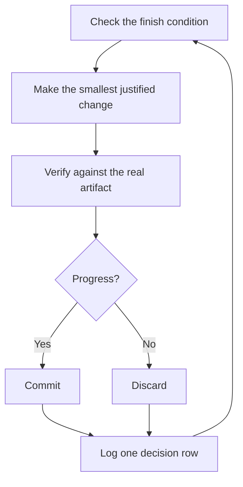

# Run work while you sleep

This is the payoff for everything before it. An agent you can trust to verify its own work is an agent you can leave alone with a hard task. What makes that safe isn't hope. It's a checkable finish condition, an isolated worktree or Cloud worker, and a decision log you audit in the morning.


## Earn the trust before the loop

A loop you don't trust just produces unchecked work faster, and the mess compounds with every iteration. Before you leave one running, check that it has earned it:

- You've done the task once by hand, or watched an agent do it, so you know what good looks like.
- The agent has the tools and signals you'd use yourself: the verification skill, the profiler, the logs.
- Every stage proves its work and can stop the line when the work misses the bar.
- You've read a few transcripts and turned the repeated failures into tools, skills, or checks.

Make the loop autonomous only after all four hold. Until then, run it while you watch.

## The overnight contract

A good handoff has the goal, the finish condition, permissions, and an escape hatch. It doesn't need to be long:

```text
/huajar-stack:huajar-mode im going to bed. migrate every caller to the new parser in a fresh worktree off <base>.
done means zero old callers, all parser fixtures pass, old api deleted.
keep a decision log. don't ask me before committing.
/loop until done. if you're truly stuck after a few hours, stop and write up why.
```

Walk through what each line buys you:

- "im going to bed" is a session override. The agent stops asking and keeps going.
- "done means..." turns the goal into checks every iteration can run.
- "fresh worktree off `<base>`" keeps the run from colliding with anything else you have open.
- "don't ask me before committing" pre-answers the permission the agent would otherwise block on.
- `/loop` is Claude Code's built-in wake mechanism, a [bundled skill](https://code.claude.com/docs/en/scheduled-tasks), not a huajar-stack skill. The [Autonomous run playbook](../../skills/huajar-mode/playbooks/autonomous-run.md) uses it to re-check the finish condition on events or a heartbeat.
- The escape hatch lets it stop at a genuine dead end and write up why, which beats eight hours of creative goal reinterpretation.

"don't ask me before committing" stops the agent from asking, but it doesn't stop Claude Code. In [auto mode](https://code.claude.com/docs/en/permission-modes), a classifier judges each command on its own. An approval you give in chat clears a block only when it names the action and its specifics, and it covers that one action, so a later push, merge, or tracker write can still be denied while you sleep. Before you leave, ask the agent to list the external commands the run needs and hand you one ready-to-paste block of narrow [`permissions.allow` rules](https://code.claude.com/docs/en/permissions), such as `Bash(gh pr create *)`. Paste it into the settings file the agent names. The agent can't write it for you, because the classifier blocks its own settings edit. Each rule must match the shell tool the run uses, `Bash(...)` or `PowerShell(...)`. An allow rule does not cover writes under `.claude`, so make any settings edit the run needs yourself before you go. Don't count on a prefix deny-glob to fence the run. A reworded command gets around it.

Because you'll review this work after stepping away, `/huajar-stack:huajar-mode` routes it through [`/huajar-stack:figure-it-out`](../../skills/figure-it-out/SKILL.md), which designs the run's phases before any code and wires in the decision log.

To stop a run on purpose, tell the agent to pause, or that you're about to go offline or restart Claude Code. The [Pause safely playbook](../../skills/huajar-mode/playbooks/pause-safely.md) finishes or backs out of the current step, commits a work-in-progress checkpoint, and writes a resume note. A fresh chat picks the work up from that note through the Session pickup playbook. Saying "keep going" never triggers a pause.

## What the loop does all night



One change, one check, one log row, every iteration. Changes that didn't help get discarded, not left to ride. A plateau means pivot, not stop, and the finish condition never quietly relaxes to declare victory.

## The morning audit

[`/huajar-stack:show-me-your-work`](../../skills/show-me-your-work/SKILL.md) is what makes the run reviewable. Each row records the time, phase, decision, reason, an evidence pointer, and the result, in a TSV at `decisions.tsv` (or `.audit/<task-slug>.tsv` when several runs share a directory). It stays local by default. Commit it when the work is ambitious enough that a reviewer needs the trail to trust the result.

When you're back, ask for the run in review form:

```text
/huajar-stack:show-me-your-work catch me up on what you did last night
```

Before the skill hands back its summary, it spawns a reviewer on Opus to read the trail and the transcript, and the reply ends with an Attention section listing what deserves your scrutiny. Read that section first, then the log rows it points at. You're auditing decisions, not re-reading the whole night.

For a quick status instead of an audit, run [`/huajar-stack:ketchup`](../../skills/ketchup/SKILL.md) in the chat that ran the work. It reads only, and tells you in plain words what changed since your last message, with the screenshots and small diagrams the work produced. Then it lists each call waiting on you, such as a merge, an approval, or a choice between options, with its pick, the evidence, and the risk, so you can decide from the reply alone.

## When the night holds a queue, not a task

The contract above drives one task to one finish condition. Some nights hold more, a queue of independent changes or a whole program. Two playbooks and one skill scale the same trust up.

[Autopilot-full](../../skills/huajar-mode/playbooks/autopilot-full.md) runs a queue of independent PRs to merged. Each PR gets one owner agent that carries it from build through merge, and no owner merges on its own verdict. A swarm of fresh verifiers checks the owner's code-ready head. A later rebase or minor fix gets one fresh verifier, and only new behavior or a large new diff calls the full swarm again. Only a clean verdict on the patch that merges authorizes the merge:

```text
/huajar-stack:huajar-mode full autopilot on this queue. each item is independent. i want them merged by morning.
```

[Autopilot-stack](../../skills/huajar-mode/playbooks/autopilot-stack.md) is Autopilot-full without the merge. You wake up to verified PRs, each with its verdict, and you review and land them yourself. A PR stacks only on a PR it builds on. Pick it over Autopilot-full when you want your own eyes on the work before anything merges:

```text
/huajar-stack:huajar-mode autopilot these five changes, but don't merge. i'll land them in the morning.
```

A whole program, such as a migration across many packages, has no playbook of its own. `/huajar-stack:huajar-mode` routes large or cross-cutting work to [`/huajar-stack:figure-it-out`](../../skills/figure-it-out/SKILL.md), which designs one rigorous run for it:

```text
/huajar-stack:huajar-mode migrate every package to the new store. own it until each one is converted and merged. i'll check in twice a day.
```

Autopilot-full and Autopilot-stack start their workers and verifiers as Cloud workers by default, `claude --cloud` sessions that the coordinator launches from `hc` terminals, per [the cloud workers reference](../../skills/huajar-mode/references/cloud-workers.md). The coordinator stays in your chat in a Herdr app terminal, so leave the machine running and the Herdr app open. Before the first Cloud worker, the run checks that the cloud environment can reach the repository and that huajar-stack is enabled on claude.ai, and stops the cloud path if either is missing. Work that needs this machine runs as Local workers. [Route work through `/huajar-stack:huajar-mode`](./02-huajar-mode.md#give-parallel-work-its-own-machine) covers the setup.

## Run many projects in parallel

A [Claude Code Project](https://code.claude.com/docs/en/claude-projects) gives one coordinator agent a persistent conversation. Projects are in public beta on Pro and Max plans, and they run at claude.ai/code, in the desktop app, and in the mobile app, not in the terminal CLI. The coordinator doesn't write code. It directs threads, which run in the cloud by default, so the work continues when your laptop is closed. Add huajar-stack in **Project settings > Plugins**, so each cloud thread loads it, and ask the coordinator to start each thread with `/huajar-stack:huajar-mode`, so the threads follow the playbooks. Each agent it starts reads [`worker.md`](../../skills/huajar-mode/worker.md) first, so workers hold to the kickoff's bar, decide reversible calls instead of asking you, and open PRs ready for review.

A few habits help:

- Give each body of work its own Project, such as a feature, a migration, a perf push, or a tech-debt cleanup. Several can run side by side.
- Move related cloud sessions into the Project with **Move to project**, finished ones included. Claude reads each one, and what you ask it to remember goes to project memory, which every new cloud thread reads.
- Give each PR a verification swarm before it merges, and let Autopilot-stack or Autopilot-full carry the queue.
- Ask the coordinator for a plan backed by data, and have it answer open questions with prototypes before it asks you.

One prompt can carry a whole Project, from research through execution:

```text
/huajar-stack:huajar-mode refactor this repo so its architecture is more agent friendly. use /huajar-stack:correct and /huajar-stack:architect on past commits and review comments to find the mistakes agents make most here. use /huajar-stack:recall for context from past chats. answer open questions with prototypes instead of asking me. come back with a plan backed by real data. once i approve it, run it with autopilot-stack or autopilot-full, and ask me which.
```

## Let loops start themselves

Every loop above still waits for you to start it. A [routine](https://code.claude.com/docs/en/routines), which runs a saved prompt on a schedule, on an API call, or on a GitHub event, removes that step. Software maintenance splits into stages that suit this well: triage a report, reproduce it, fix it, verify the fix. Two rules keep such a line trustworthy:

- Every stage can stop the line. Triage can decide the report is expected behavior, repro can fail to reproduce it, and the fixer can judge the change too risky. Each of those outcomes is useful, because it keeps bad work from reaching the next stage, where it costs more to undo.
- Every stage hands over evidence. Repro attaches screenshots and video of the broken state, and the fix attaches before-and-after proof. A human can then check that the agent fixed the right thing before reading a line of code.

**Pitfall:** a duration is not a finish condition. "work on this for 4 hours" gives the agent nothing to check, and you'll wake up to four hours of motion instead of a result. Give `/loop` a predicate that can pass or fail.

Next: [Steer with principle names](./08-principles.md).
